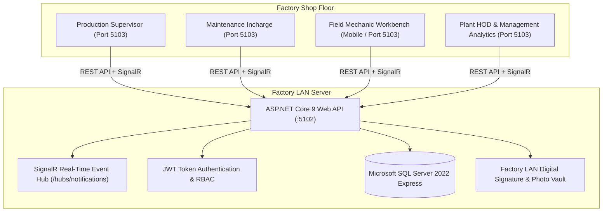
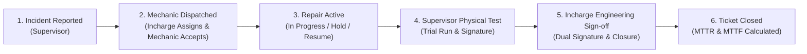

# AMAC - Machine Breakdown & Maintenance Management System (MBMS)

An enterprise industrial breakdown and maintenance execution system engineered specifically for **Asiaan Metals & Aluminium Casting Pvt Ltd (AMAC Unit 5 - U5)**. Built for 100% on-premises factory LAN deployment across high-duty foundries, CNC machine shops, stamping presses, and utility compressor lines.

---

## 🏭 System Architecture



### Technology Stack
* **Frontend:** React 19, Vite, Tailwind CSS, Lucide Icons, Canvas Digital Signatures, SignalR Client.
* **Backend:** ASP.NET Core 9 Web API, Entity Framework Core 9, SignalR Hub, JWT Authentication, BCrypt Password Hashing.
* **Database:** Microsoft SQL Server 2022 Express (28 normalized industrial tables with audit logs and downtime intervals).
* **Network:** 100% On-Premises Factory LAN (`0.0.0.0:5102` API, `0.0.0.0:5103` Frontend).

---

## 🔄 Complete 6-Step Breakdown Lifecycle

The system enforces strict segregation of duties across all 6 breakdown lifecycle stages:



1. **Step 1: Incident Reported (NEW)**
   * Line supervisor logs breakdown with primary symptom, priority (LOW, MEDIUM, HIGH, CRITICAL), and initial breakdown photos.
   * Machine downtime interval starts immediately (`MachineDowntime.StartedAt`).
   * Real-time SignalR alert dispatched to maintenance dispatchers.

2. **Step 2: Technician Dispatched & Accepted (ASSIGNED / ACCEPTED)**
   * Maintenance Incharge dispatches an on-shift mechanic based on live active ticket counts and specialization (Mechanical, Electrical, Hydraulics, Pneumatics).
   * Technician accepts assignment on their mobile/tablet workbench.

3. **Step 3: Corrective Repair Execution (IN_PROGRESS / ON_HOLD)**
   * Active labor work sessions tracked per technician (`TicketWorkSessions`).
   * Support for pause/hold reasons (Awaiting Spare Parts, Specialist Vendor, Shift End Handover) with active labor isolation.
   * Spare parts consumption recorded with automated real-time inventory deduction from `SpareParts` master.
   * Technician logs inspection findings, actual root cause, corrective actions, post-repair condition, and repair completion photos.

4. **Step 4: Supervisor Physical Verification (AWAITING_SUPERVISOR)**
   * Original production supervisor (or on-duty shift supervisor) inspects the machine running in trial production.
   * Mandates physical digital signature (`SignaturePad`) upon approval.
   * Rework rejection returns ticket to mechanic with mandatory remarks.

5. **Step 5: Maintenance Incharge Engineering Sign-off (AWAITING_INCHARGE)**
   * Maintenance Incharge verifies mechanical integrity and root-cause countermeasures.
   * Mandates secondary digital signature (`TicketSignatures`).
   * Closes machine downtime interval and decrements technician active tickets.

6. **Step 6: Closed & KPI Calculation (CLOSED)**
   * Mathematical MTTR (Mean Time to Repair), MTTF (Mean Time to Failure), and MTBF (Mean Time Between Failures) calculated and displayed on ticket summary.
   * Reopen workflow available for premature line stoppages within warranty/trial window.

---

## 📊 Industrial KPIs & Formulas

* **MTTR (Mean Time To Repair):**
  $$\text{MTTR} = \frac{\sum (\text{Repair Completed Timestamp} - \text{Work Started Timestamp})}{\text{Total Completed Repairs}}$$
* **MTTF (Mean Time To Failure):**
  $$\text{MTTF} = \frac{\text{Total Operating Hours}}{\text{Total Breakdowns}}$$
* **MTBF (Mean Time Between Failures):**
  $$\text{MTBF} = \text{MTTF} + \text{MTTR}$$
* **Plant Availability %:**
  $$\text{Availability} = \frac{\text{Total Operating Uptime Hours}}{\text{Total Planned Production Hours}} \times 100$$

---

## 🚀 Getting Started

### Prerequisites
* [.NET 9.0 SDK](https://dotnet.microsoft.com/download/dotnet/9.0)
* [Node.js](https://nodejs.org/) (v18 or higher)
* [Microsoft SQL Server 2022 Express](https://www.microsoft.com/en-us/sql-server/sql-server-downloads)

### 1. Database Setup
Execute the SQL scripts in the `database/` directory against your local SQL Server instance (`MBMS_Production`):
1. `database/01_Schema_and_Seed.sql`
2. `database/03_Update_Indian_Personnel_and_Config.sql`

### 2. Backend Startup
```powershell
cd backend/MBMS.API
dotnet run --urls "http://0.0.0.0:5102"
```

### 3. Frontend Startup
```powershell
cd frontend
npm install
npm run dev -- --host 0.0.0.0 --port 5103
```

### 4. One-Click Windows Launcher
Run `start.bat` in the root folder to boot both backend and frontend services.
Run `stop.bat` to gracefully terminate both background daemons.

---

## 👥 Default Demo Credentials (AMAC Unit 5 - U5)

| Role | Username | Password | Access Portal |
| :--- | :--- | :--- | :--- |
| **Plant Administrator** | `admin` | `Admin@123` | Full Access & Master Configuration |
| **Maintenance Incharge** | `incharge` | `Incharge@123` | Dispatch, Engineering Sign-off & Reports |
| **Production Supervisor** | `supervisor` | `Supervisor@123` | Breakdown Intake & Trial Verification |
| **Field Mechanic** | `mechanic` | `Mechanic@123` | Mobile Workbench & Spare Parts Logging |

---

## 📁 Repository Structure

```
├── backend/
│   ├── MBMS.API/             # Controllers, SignalR Hub, Middleware, Startup
│   ├── MBMS.Application/     # DTOs, Business Interfaces
│   ├── MBMS.Domain/          # EF Core Entities, Domain Enums & Constants
│   ├── MBMS.Infrastructure/  # DbContext, Data Seeding, Core Services, Security
│   └── MBMS.Tests/           # End-to-end integration & validation tests
├── database/                 # SQL Server 2022 Express Schema and Seed scripts
├── deployment/               # IIS web.config, backup automation scripts
├── frontend/
│   ├── src/
│   │   ├── components/       # Stepper, TicketModal, SignaturePad, Badges
│   │   ├── context/          # JWT Auth Context & Permission Gates
│   │   ├── pages/            # Supervisor, Maintenance, Mechanic, Admin, Reports
│   │   └── services/         # Axios/Fetch API client & SignalR subscriber
│   ├── public/               # AMAC Plant branding & logos
│   └── vite.config.js        # Vite dev server configuration (Port 5103)
├── start.bat                 # One-click Windows factory startup launcher
└── stop.bat                  # One-click Windows graceful shutdown script
```

---

## 🔒 License & Copyright
Developed for **Asiaan Metals & Aluminium Casting Pvt Ltd (AMAC Unit 5 - U5)**.
All Rights Reserved.
